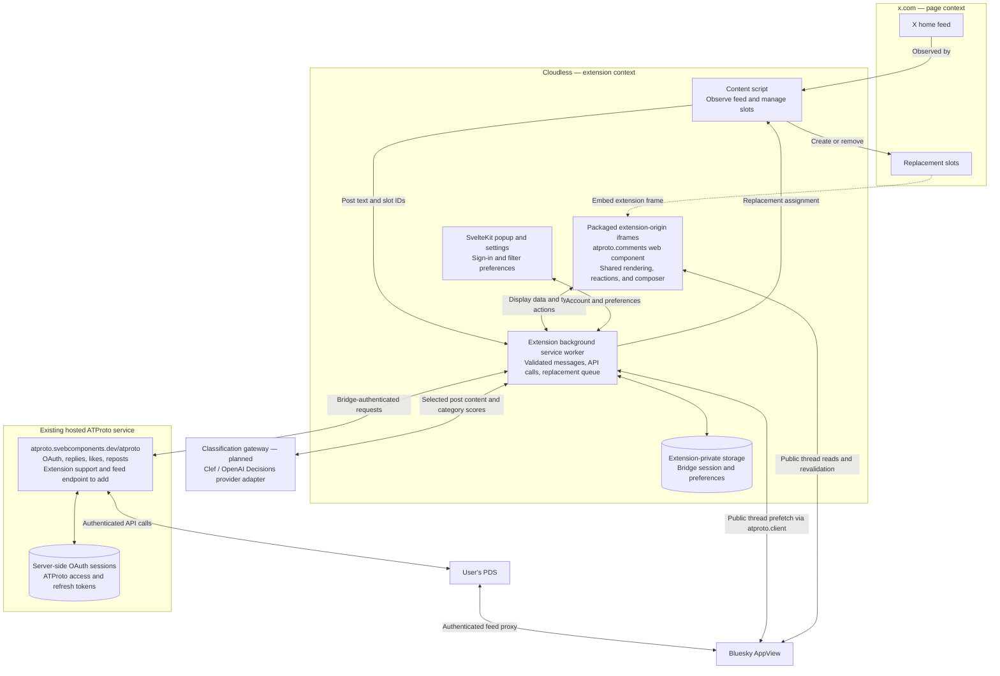
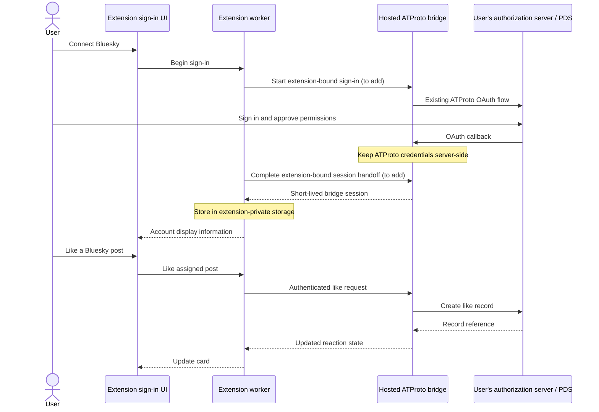

# cloudless

Clear the ragebait. Keep scrolling.

Cloudless is a browser extension that replaces unwanted posts on Twitter / X with posts from your chosen Bluesky feed. You choose what to filter, and you can like, repost, and reply to the replacements from the feed using your Bluesky account.

**Status:** architecture and planning. This repository does not contain a working extension yet. The diagrams describe the intended design; extension support and feed access still need to be added to the existing ATProto bridge.

## The idea

- Choose filters for ragebait, hate, misogyny / incel ideology, engagement farming, or your own topics and instructions.
- Tune each filter independently. Distinguish advocacy from reporting, criticism, quotation, and satire.
- Replace matching posts with unseen posts from Bluesky Discover, Following, or a custom feed you choose.
- Keep a visible Bluesky label on replacements. Likes, reposts, and replies happen on Bluesky.
- Reveal the original post, correct a classification, or pause filtering at any time.

The first target is the desktop X home feed in a Chromium Manifest V3 extension.

## Architecture

The extension manages the feed and the browser session. The existing [svebcomponents ATProto bridge](https://atproto.svebcomponents.dev/) continues to own ATProto OAuth and account credentials.



The content script runs in an isolated JavaScript world but shares X's DOM. It handles observation and placement. The cards and composer run in packaged extension-origin iframes, which give them a separate document and origin. Shadow DOM alone would only isolate styling.

The worker owns authenticated requests. Tokens stay out of X's DOM, page storage, component attributes, and page messages. Messages expose specific operations such as requesting a replacement or liking an assigned post; the worker validates the sender, frame, payload, and allowed operation.

The worker can stop between events. Session state and the replacement queue must survive a worker restart, with expired sessions refreshed when needed. Use extension storage with appropriate access restrictions; keep temporary secrets in `chrome.storage.session`, and do not sync credentials.

## ATProto integration

The post cards use the published [svebcomponents/atproto](https://github.com/svebcomponents/atproto) packages through their public APIs.

| Piece | Reuse | Integration work |
| --- | --- | --- |
| `@svebcomponents/atproto.comments` | The actual custom element: rendering, rich text, composer, reactions, live updates, public events, CSS variables, and parts | Reusable compact / collapsed presentation and an injectable session client |
| `@svebcomponents/atproto.client` | Public types, URI parsing, thread fetching and normalization, rich-text segmentation, viewer URLs, bridge API contract | Shared feed/post primitives and replaceable session storage / sign-in dependencies where needed |
| `@svebcomponents/atproto.bridge` | Hosted OAuth, server-side credentials, replies, likes / unlikes, reposts / undo | Extension sign-in handoff, origin validation, and authenticated feed access |

### Component integration

- Mount the real `<atproto-comments>` custom element inside the extension frame. Keep rendering, reaction state, optimistic updates, and reply composition in the package.
- Supply real normalized snapshots through the existing `threadData` JavaScript property and pass `fetchedAt` for freshness. Use `fetchCommentTree`, `normalizeThread`, and the exported types instead of maintaining a second thread model.
- Theme through the existing `--atproto-comments-*` properties and `::part(...)` hooks. Use the documented component events and `revalidate()` method for integration.
- Add missing general-purpose capabilities to `svebcomponents/atproto` and consume their published releases. Extension messaging, X selectors, filtering, and replacement scheduling belong in Cloudless.
- Use SvelteKit for the packaged UI shell. Personalized feed data arrives at runtime; SSR is appropriate for a separate public demo or documentation page, rather than baking a user's timeline into the extension build.

The current component is built for comment sections. Before using it for arbitrary feed posts, preserve moderation labels on the root post and explicitly handle its currently unsupported media embeds. Its `show-root` option does not yet constitute a compact, moderated feed-card API. Likewise, injecting `fetchImpl` into `ServiceClient` alone does not move its token storage or popup sign-in into the extension worker.

The [ATProto integration plan](docs/atproto-integration.md) maps the existing primitives to their uses, separates proposed APIs from shipped ones, and defines the first integration checks. Improvements to the ATProto packages should remain useful to other consumers.

The hosted bridge is an existing dependency, not something shipped inside the extension. Its current HTTP(S)-only origin validation and website-oriented login handoff need explicit extension support. This must preserve session binding rather than treating a missing origin as trusted.

The bridge currently requests narrow posting and reaction permissions. Fetching feeds as the signed-in user needs an additional API endpoint and the corresponding read / proxy permissions. Existing users may need to authorize the expanded grant.

### Sign-in and sessions

Start with the bridge's existing bearer-session design. Only the extension stores the short-lived bridge token. ATProto access tokens, refresh tokens, and confidential-client signing keys remain on the hosted service.



Real `HttpOnly; Secure` cookie sessions are a possible later transport on the HTTPS bridge. Its current cookie mode is intended for same-origin websites, so extension cookie support needs its own origin / CSRF handling and browser-policy checks. Do not switch the public bridge's existing embeds to cookie mode as part of the extension integration.

## Bluesky feed sources

The replacement source is a setting:

| Source | Bluesky API | Behavior |
| --- | --- | --- |
| Discover | `app.bsky.feed.getFeed` with the Discover feed URI | Personalized recommendations fetched using the connected account |
| Following | `app.bsky.feed.getTimeline` | The connected account's chronological following timeline |
| Custom feed | `app.bsky.feed.getFeed` with the selected feed URI | Posts from that feed, with personalization depending on its generator |

Bluesky's current client and API examples call its personalized recommendation feed **Discover**. Its feed URI is `at://did:plc:z72i7hdynmk6r22z27h6tvur/app.bsky.feed.generator/whats-hot`. A separately named "For You" custom feed is identified by its own URI, rather than its display name.

Fetch personalized feeds through the bridge's authenticated PDS / AppView path. Keep language preferences, opaque pagination cursors, and feed context with the selected source. The first-party app also applies its own preferences, filtering, and feedback, so Cloudless should not promise an identical stream to an open Bluesky tab.

Sources: [Bluesky feed API guide](https://bsky.network/docs/bluesky-api/viewing-feeds/#feed-generators) and [Bluesky's feed client](https://github.com/bluesky-social/social-app/blob/main/src/lib/api/feed/custom.ts).

## Building with SvelteKit

SvelteKit can build the extension's UI. Its [browser-extension documentation](https://svelte.dev/docs/kit/project-types#Browser-extension) supports using [`adapter-static`](https://svelte.dev/docs/kit/adapter-static) for this target.

| Build output | Responsibility |
| --- | --- |
| Static SvelteKit pages | Popup, settings, sign-in UI, and embedded card / composer pages |
| Separate TypeScript background bundle | Manifest V3 service worker and extension APIs |
| Separate TypeScript content-script bundle | X feed observation and slot placement |
| Packaged manifest and assets | Entry points, host permissions, CSP, and the resources X may embed |

Proposed source layout, to be created when implementation starts:

```text
src/
  routes/
    popup/             # Toolbar popup
    settings/          # Filter and account settings
    card/              # Extension iframe UI
  lib/
    atproto/           # Component and client adapters
    classification/    # Category definitions and provider interface
    messaging/         # Shared, validated message contracts
  extension/
    background.ts      # Manifest V3 background worker
    content.ts         # X feed adapter
static/
  manifest.json
```

Prerender the UI routes to explicit HTML files that the manifest and iframe URLs can reference. Keep all executable UI code in the extension package. The build must emit CSP-compatible external scripts, including any SvelteKit bootstrap code; SvelteKit's generated CSP hashes do not replace the extension manifest's restrictions.

SvelteKit's PWA service-worker registration is separate from the extension's background worker. Disable automatic web service-worker registration and declare the extension worker in `manifest.json`. Runtime server routes, form actions, and server-only modules stay on a hosted server; `adapter-static` does not turn them into extension-worker handlers.

The first build spike should verify static page loading, relative asset paths, the extension CSP, iframe embedding, and worker messaging in a real unpacked extension. Bundle the published web-component entry locally; the package's `./svelte` export currently supplies types rather than a native Svelte runtime component.

## Filtering and replacements

The worker checks explicit user rules and cached decisions first, then sends selected content to a classifier when necessary. Categories produce independent scores; user settings decide which scores trigger replacement. Quoted content and the post's stance should be considered together.

Keep the provider replaceable. [Clef-flash](https://developers.cloudflare.com/workers-ai/models/clef-flash/) and [OpenAI Decisions](https://developers.openai.com/api/docs/guides/decisions) are candidates, to be evaluated on the same labeled examples for false positives, latency, and cost. Model probabilities need evaluation against actual posts before becoming user-facing sensitivity thresholds.

Cloud classification requires an explicit choice about sending post content to a provider. A hosted classification gateway would hold any shared provider credentials; those credentials must not be bundled into a public extension. This gateway is planned work, separate from the existing ATProto bridge.

Fetch Bluesky posts into a bounded queue, preserve the selected feed's returned order, and deduplicate by post URI. Scope the queue and cursors to the account, source, and language preferences; clear them when those settings change. Classify X posts just ahead of the viewport to reduce flashes of unwanted content. If classification is unavailable or the selected feed cannot supply a replacement, use a neutral placeholder with a show-original control. Keep the choice reversible.

Replacing a post changes what is displayed locally. X has already delivered the original post and may still record its own feed telemetry.

## First milestones

1. Package the actual ATProto web component in a SvelteKit extension page and verify snapshots, theming, iframe layout, and worker messaging.
2. Add reusable session-client injection and extension bridge support upstream; verify sign-in, existing reaction state, a real like / unlike, and a reply using the component's own UI.
3. Add Discover / Following / custom feed access and safe feed-card presentation upstream, then a source-aware replacement queue and stable replacement across X feed rerenders in Cloudless.
4. Add configurable filters, classifier evaluation, and reveal / undo controls.

See also: [Chrome content scripts](https://developer.chrome.com/docs/extensions/develop/concepts/content-scripts), [extension messaging](https://developer.chrome.com/docs/extensions/develop/concepts/messaging), and [extension CSP](https://developer.chrome.com/docs/extensions/reference/manifest/content-security-policy).
